# BayesIRTplot

## Overview

The `BayesIRTplot` package can be used to generate plots for Bayesian
item response theory (IRT) models fitted in `blavaan`.
[`BayesIRTplot()`](../reference/BayesIRTplot.md) reads in a fitted IRT
model from `blavaan`. The current version supports unidimensional
two-parameter IRT models for binary items. The following types of plots
are available: Item-Person Map (IPM), Item Characteristic Curve (ICC),
Item Information Curve (IIC), Test Characteristic Curve (TCC), Test
Information Curve (TIC), and Marginal Reliability Plot (REL). This
vignette provides examples for use of the `BayesIRTPlot` package.

A fitted `blavaan` object (`tma.IRT.fitted.model`) is included in the
package and it is used throughout the examples. Details on data source,
data preparation and model fitting are provided at the end.

``` r

# attach the package
library(BayesIRTplot)
# load the example blavaan fitted model 
data("tma.IRT.fitted.model")
```

### Item-Person Map

IPM shows the box plots of each item’s threshold ($`\tau`$) parameter,
summarizing across all posterior draws using Q1, Q3, median, and the
lower and upper whiskers (calculated as Q1 − 1.5 × IQR and Q3 + 1.5 ×
IQR, respectively).

``` r

BayesIRTplot(tma.IRT.fitted.model, IRTplot = "IPM") 
```

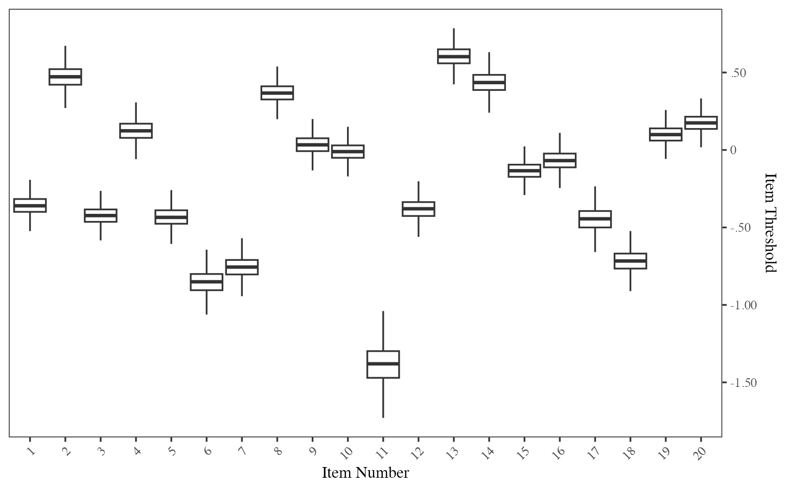

### Item Characteristic Curve

In ICC, each grey line shows the probabilities of a correct response in
one posterior draw, while the black line shows the mean across all
posterior draws.

ICC is plotted over a latent trait ($`\theta`$) range of -6 to 6. The
same $`\theta`$ range is used for IIC, TCC, and TIC plots.

By default, all items will be plotted. We can specify a few items by
providing a list of item numbers with item names (optional). ICC can be
generated as separate plots for each item, several items in a panel, or
several items overlaid in one plot.

``` r

# ICC for 3 items, with item names
BayesIRTplot(tma.IRT.fitted.model, IRTplot = "ICC", items_ICC_IIC = c(1, 4, 6), 
             item_names_ICC_IIC = c("ItemName1", "ItemName2", "ItemName3"))
```

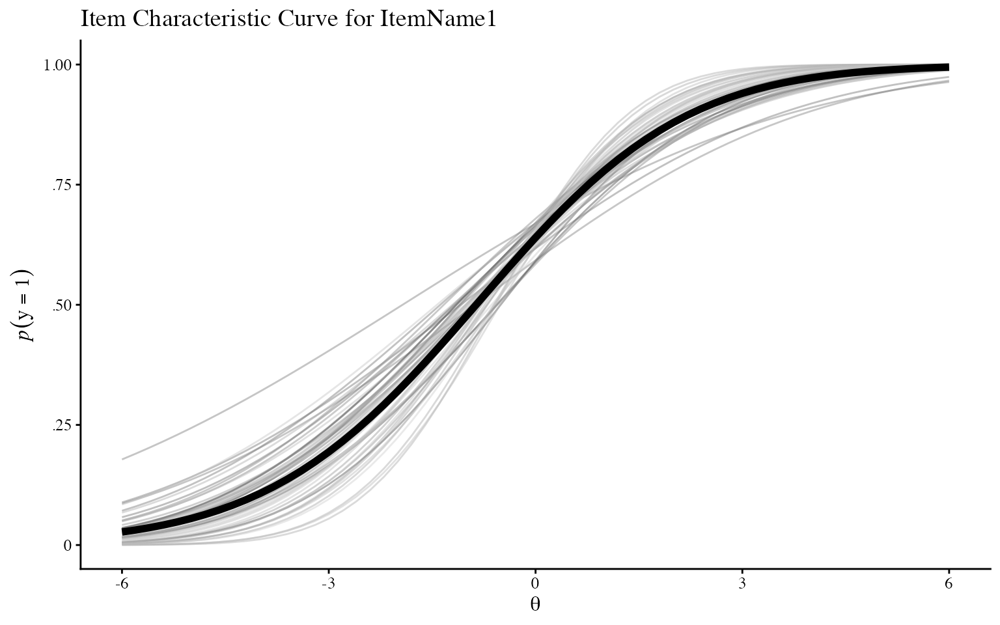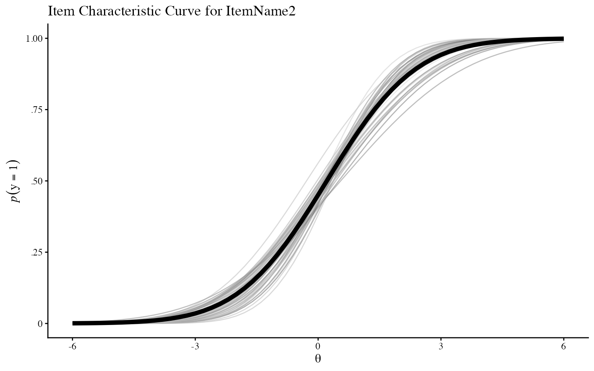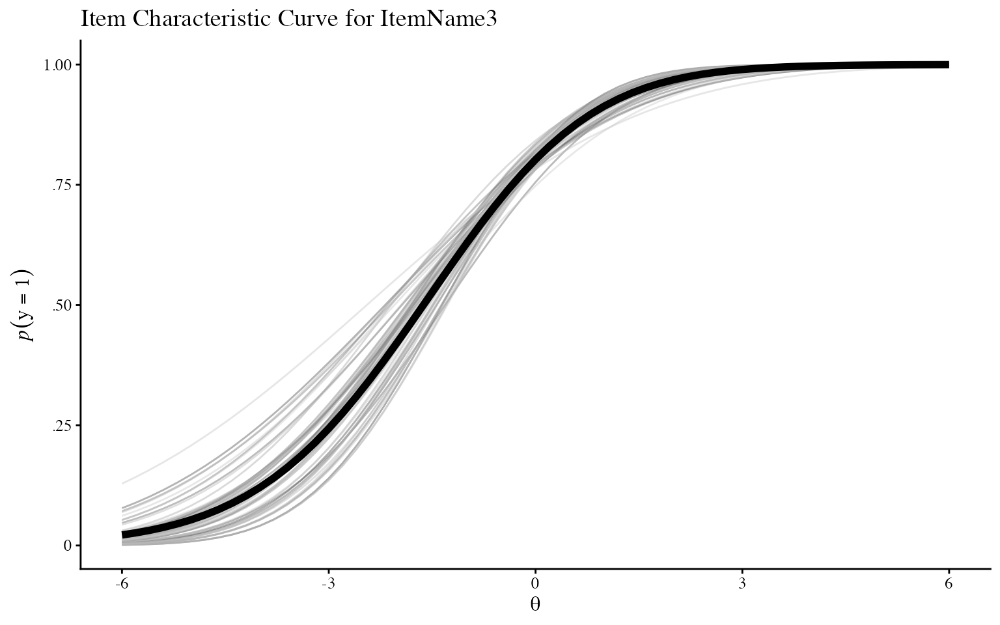

``` r


# panel ICC
# specify a maximum of 4 items and 2 columns in a panel
BayesIRTplot(tma.IRT.fitted.model, IRTplot = "ICC", items_ICC_IIC = c(1:8), 
             plot_option_ICC_IIC = "panel", max_plots_panel = 4, ncol_panel = 2) 
```

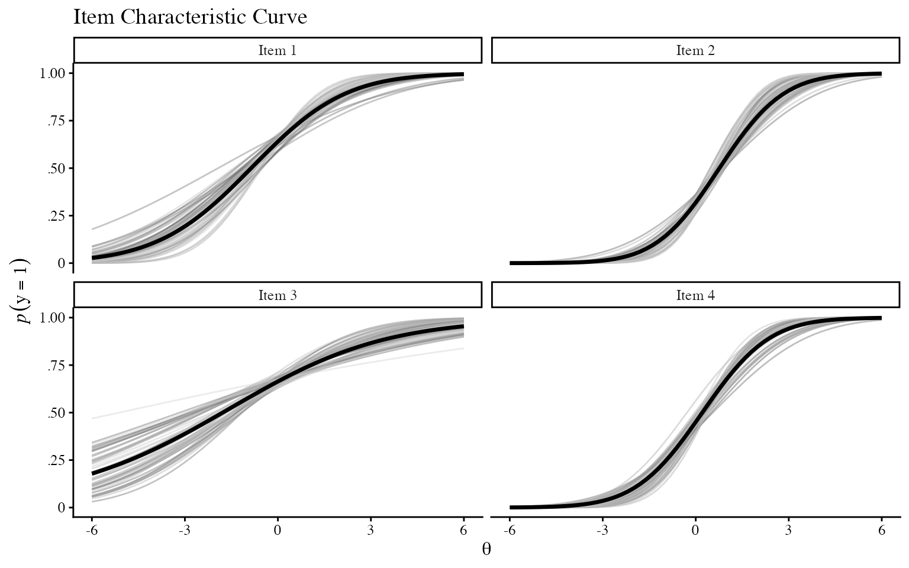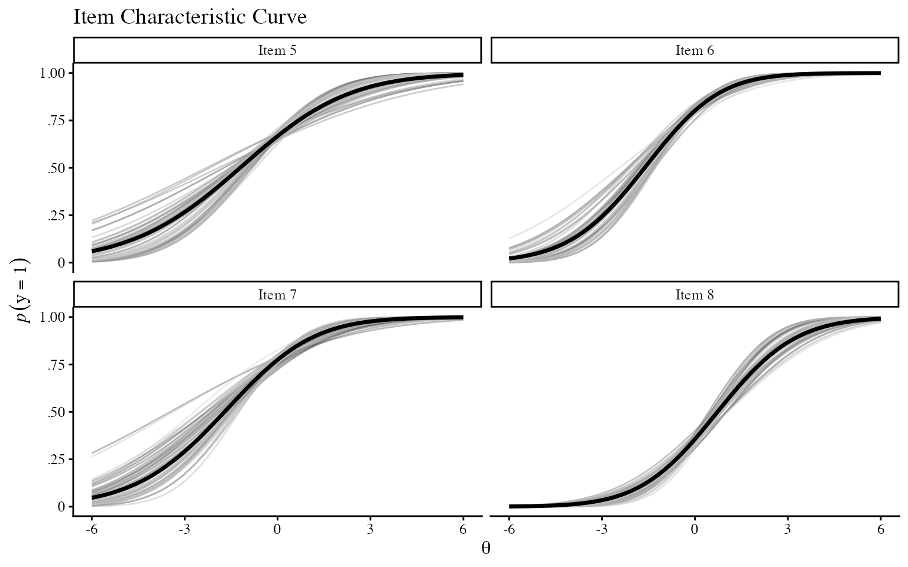

``` r


# overlaid ICC
BayesIRTplot(tma.IRT.fitted.model, IRTplot = "ICC", items_ICC_IIC = c(1,2,3), 
             plot_option_ICC_IIC = "overlay") 
```

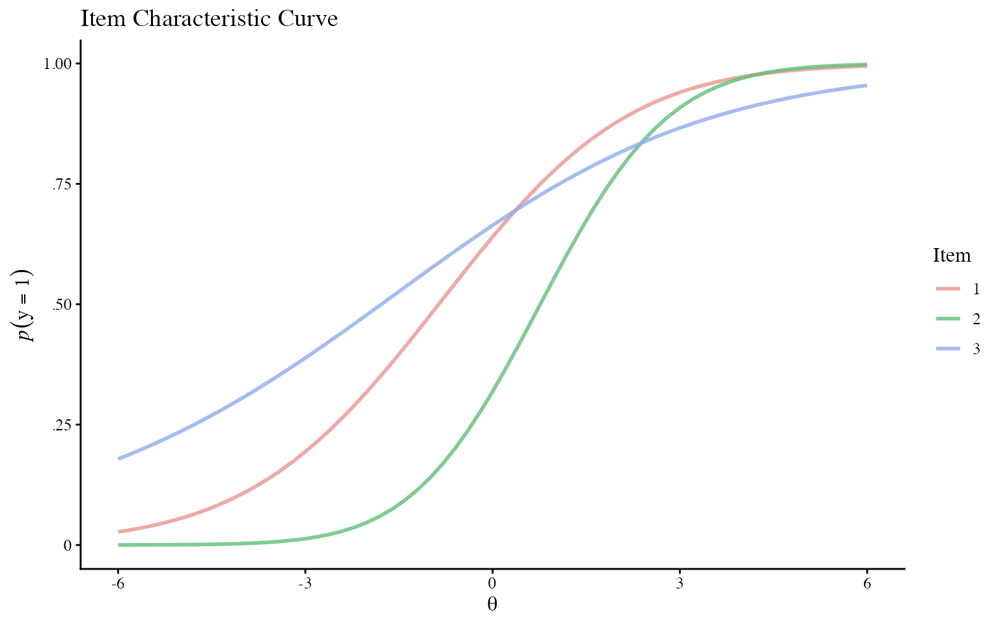

``` r


# overlaid ICC by line types (instead of colors) for different items
BayesIRTplot(tma.IRT.fitted.model, IRTplot = "ICC", items_ICC_IIC = c(1,2,3), 
             item_names_ICC_IIC = c("ItemName1", "ItemName2", "ItemName3"), 
             plot_option_ICC_IIC = "overlay", overlay_style = "line") 
```

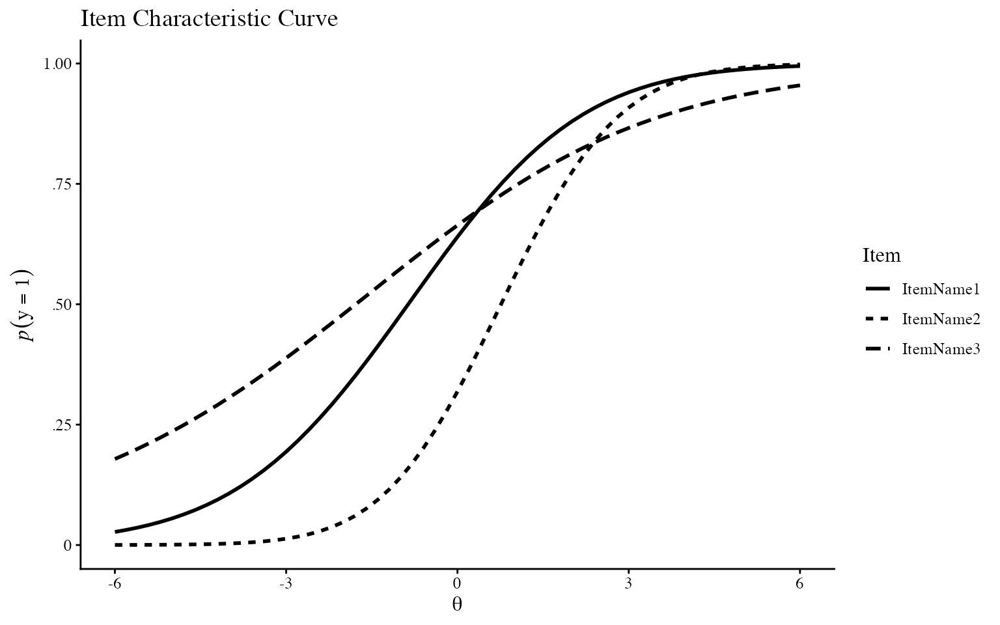

### Item Information Curve

In IIC, each grey line shows the item information in one posterior draw,
while the black line shows the mean across all posterior draws. IIC
plots can be requested in the same way as ICC.

``` r

# panel IIC
BayesIRTplot(tma.IRT.fitted.model, IRTplot = "IIC", items_ICC_IIC = c(1, 3, 5, 6, 10, 12), 
             plot_option_ICC_IIC = "panel") 
```

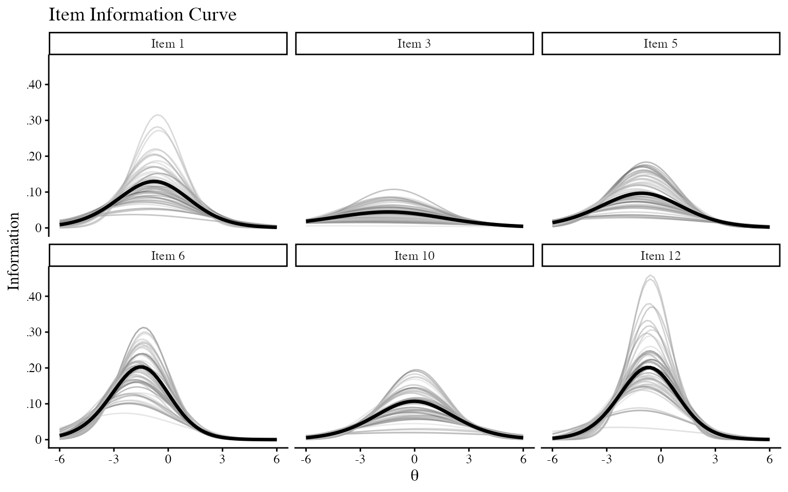

### Test Characteristic Curve

In TCC, each grey line shows the expected test score in one posterior
draw, while the black line shows the mean across all posterior draws.

``` r

BayesIRTplot(tma.IRT.fitted.model, IRTplot="TCC") 
```

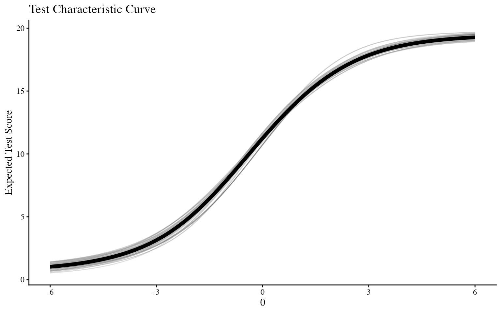

### Test Information Curve

In TIC, each grey line shows the test information in one posterior draw,
while the black line shows the mean across all posterior draws.

``` r

BayesIRTplot(tma.IRT.fitted.model, IRTplot="TIC")
```


### Marginal Reliability Plot

Marginal reliability plot is a histogram of marginal reliability in each
posterior draw. The mean marginal reliability based on all posterior
draws is indicated by the dashed vertical line and can be printed using
[`BayesIRTdata()`](../reference/BayesIRTdata.md).

``` r

BayesIRTplot(tma.IRT.fitted.model, IRTplot="REL") 
```

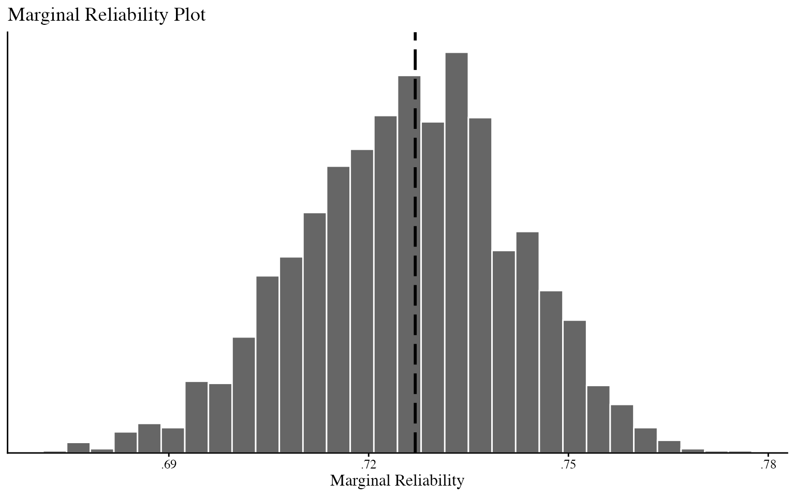

``` r


# mean marginal reliability based on all posterior draws
data <- BayesIRTdata(tma.IRT.fitted.model)
data$mean_reliability
#> [1] 0.7269934
```

### Other plotting features

#### Number of posterior draws plotted

For ICC, IIC, TCC and TIC, by default, the first 50 posterior draws will
be plotted as separate lines. The number of posterior draws plotted can
be changed. Note that the mean probability and mean information are
calculated using all posterior draws from `blavaan` fitted object,
regardless of how many posterior draws are plotted as separate lines.

``` r

# plot the first 1000 posterior draws
BayesIRTplot(tma.IRT.fitted.model, IRTplot = "TIC", DrawsK = 1000) 
```

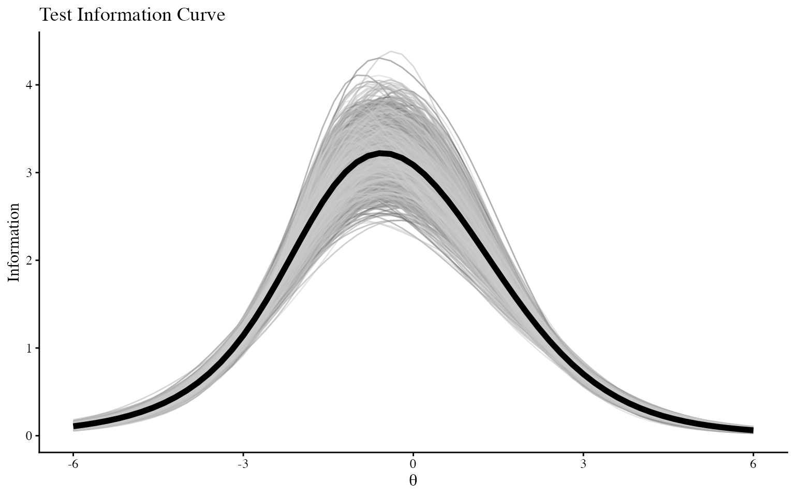

#### Create multiple types of plots

Multiple types of plots can be requested at the same time. By default,
all types of plots are generated, the code below demonstrates how to
specify selected types of plots.

``` r

# request ICC in a panel and TIC
BayesIRTplot(tma.IRT.fitted.model, IRTplot = c("ICC", "TIC"), items_ICC_IIC = c(5,6,8), 
             plot_option_ICC_IIC = "panel")
```

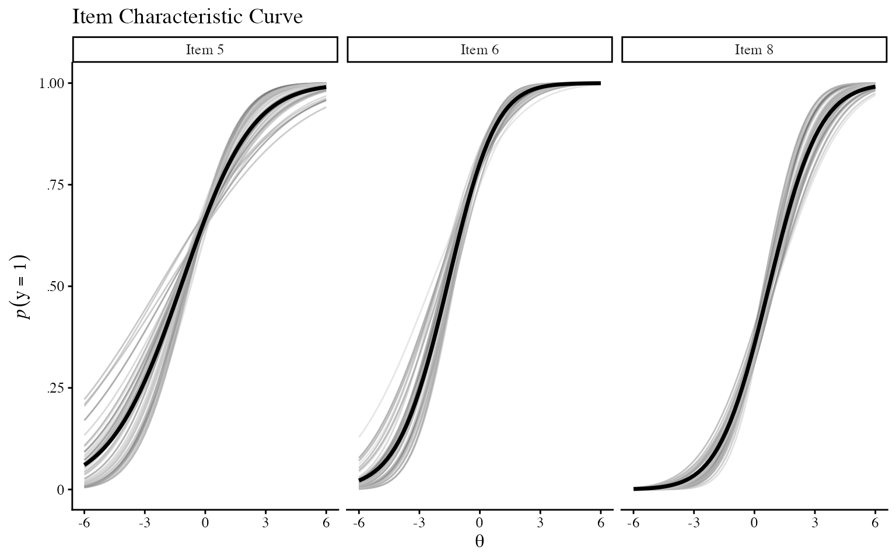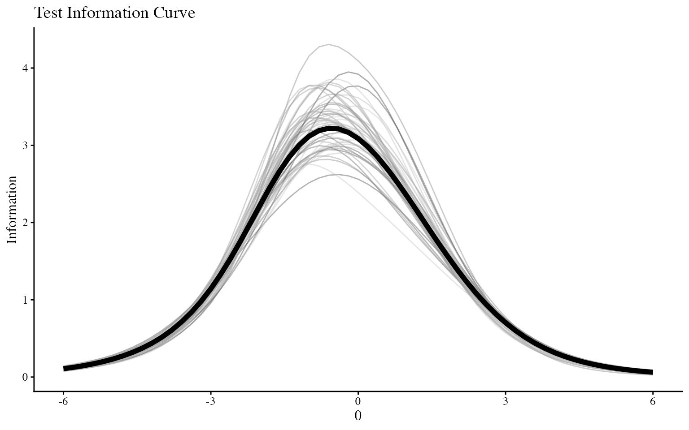

#### Save plots to local directory

By specifying `save_plots = TRUE`, each plot will be saved as a png
file. The default directory is the current working directory. `save_dir`
can be used to specify an absolute path or a relative path within the
working directory.

Individual plots can also be accessed from the returned list. See
?BayesIRTplot for more details.

``` r

# save plots in a subdirectory
BayesIRTplot(tma.IRT.fitted.model, 
             save_plots = TRUE, save_dir = "Plots") 

# suppress printing all plots
plots <- BayesIRTplot(tma.IRT.fitted.model, print_plots = FALSE)
# access IPMplot
plots$IPMplot
```

### Access datasets used for plotting

[`BayesIRTdata()`](../reference/BayesIRTdata.md) can be used to return a
list of datasets used in plotting. See ?BayesIRTdata for more details.

``` r

datasets <- BayesIRTdata(tma.IRT.fitted.model) 
# access dataset 'summary_by_item'
datasets$summary_by_item
```

### Data source, data preparation and model fitting

The example fitted model uses the publicly available dataset “tma” from
Item Response Warehouse, which can be accessed and downloaded from
<https://itemresponsewarehouse.org/data.html>

\
In this example, a Bayesian unidimensional two-parameter item response
theory (IRT) model was fit in Stan via the R package `blavaan` in R
(Merkle et al., 2021; R Core Team, 2026). Two chains were run for the
Markov chain Monte Carlo (MCMC) algorithm, the first 500 iterations were
specified as warm-up for each chain, and then 1,000 iterations from each
chain after warm-up were obtained and saved. Default thinning by 1 was
included in the model to keep every iteration. For model specification,
the factor loadings on the latent factor were freely estimated, with one
threshold for each item. Below is the code for data preparation and
model fitting using `blavaan`.

``` r

# call the relevant libraries
library(tidyr)
library(blavaan)
```

``` r

# read in data
# replace with the path in your local directory
df <- read.csv("path/to/tma.csv")

# convert long format into wide format to fit the IRT model
# where each row contains responses for one person
df_wide <- df %>%
  pivot_wider(
    names_from = item,
    values_from = resp
  )

# for the purpose of this example, we use a random sample of 500 people
set.seed(123)
df_demo <- df_wide[sample(1:nrow(df_wide), 500), ]

# for the purpose of this example, we use the first 20 items
# create item list: Q1-Q20
items <- paste0("Q", 1:20)

# define the IRT model
blavaan.model <- paste0(
'# discrimination parameters:
F1 =~ ',
paste(items, collapse = " + "), "\n",
'# threshold parameters: ', "\n",
paste0(items, " | t1", collapse = "\n")
)

# specify features of MCMC 
n.chains = 2 # number of chains
n.burnin = 500 # number of burnin
n.sample = 1000 # number of samples after burnin (per chain)

# fit the model in blavaan 
# the default priors will be used
tma.IRT.fitted.model <- blavaan(
  blavaan.model, 
  n.chains = n.chains,
  burnin = n.burnin,
  sample = n.sample,
  bcontrol = list(cores = n.chains),
  data = df_demo,
  ordered = items,
  std.lv = TRUE
)
```

### Citation

If you use `BayesIRTplot` in your work, please cite the package by using

``` r

citation("BayesIRTplot")
```

### References

Taylor, J. A. (1953). A personality scale of manifest anxiety. *The
Journal of Abnormal and Social Psychology, 48*(2), 285-290.
<https://doi.org/10.1037/h0056264>

Datapages. (2026). *Item Response Warehouse* (Version 43.0), *tma*
\[Table\]. Redivis (<DOI:10.71778/V2DW-7A53>).
<https://stanford.redivis.com/datasets/as2e-cv7jb41fd/tables/hd62-026kwagr9?v=43.0>

Merkle, E. C., FitzSimmons, E., Uanhoro, J., & Goodrich, B. (2021).
Efficient Bayesian Structural Equation Modeling in Stan. *Journal of
Statistical Software, 100*(6), 1–22.
<https://doi.org/10.18637/jss.v100.i06>

R Core Team (2026). *R: A Language and Environment for Statistical
Computing.* R Foundation for Statistical Computing, Vienna, Austria.
<doi:10.32614/R.manuals> <https://doi.org/10.32614/R.manuals>.
<https://www.R-project.org/>.

### Session information

``` r

sessionInfo()
#> R version 4.6.0 (2026-04-24)
#> Platform: aarch64-apple-darwin23
#> Running under: macOS Tahoe 26.6.2
#> 
#> Matrix products: default
#> BLAS:   /Library/Frameworks/R.framework/Versions/4.6/Resources/lib/libRblas.0.dylib 
#> LAPACK: /Library/Frameworks/R.framework/Versions/4.6/Resources/lib/libRlapack.dylib;  LAPACK version 3.12.1
#> 
#> locale:
#> [1] en_US.UTF-8/en_US.UTF-8/en_US.UTF-8/C/en_US.UTF-8/en_US.UTF-8
#> 
#> time zone: America/Phoenix
#> tzcode source: internal
#> 
#> attached base packages:
#> [1] stats     graphics  grDevices utils     datasets  methods   base     
#> 
#> other attached packages:
#> [1] BayesIRTplot_0.1.0
#> 
#> loaded via a namespace (and not attached):
#>  [1] gtable_0.3.6        xfun_0.61           bslib_0.12.0       
#>  [4] ggplot2_4.0.3       QuickJSR_1.11.0     htmlwidgets_1.6.4  
#>  [7] inline_0.3.21       CompQuadForm_1.4.4  lattice_0.23-1     
#> [10] quadprog_1.5-8      vctrs_0.7.3         tools_4.6.0        
#> [13] generics_0.1.4      stats4_4.6.0        parallel_4.6.0     
#> [16] sandwich_3.1-3      tibble_3.3.1        pkgconfig_2.0.3    
#> [19] Matrix_1.7-6        RColorBrewer_1.1-3  S7_0.2.2           
#> [22] desc_1.4.3          RcppParallel_6.2.1  tmvnsim_1.0-2      
#> [25] lifecycle_1.0.5     compiler_4.6.0      farver_2.1.2       
#> [28] textshaping_1.0.5   mnormt_2.1.2        codetools_0.2-20   
#> [31] htmltools_0.5.9     sass_0.4.10         bayesplot_1.16.0   
#> [34] yaml_2.3.12         tidyr_1.3.2         pillar_1.11.1      
#> [37] pkgdown_2.2.0       jquerylib_0.1.4     MCMCvis_0.16.5     
#> [40] cachem_1.1.0        StanHeaders_2.39.1  parallelly_1.48.0  
#> [43] lavaan_0.7-2        rstan_2.32.7        tidyselect_1.2.1   
#> [46] digest_0.6.39       mvtnorm_1.4-2       future_1.76.0      
#> [49] purrr_1.2.2         listenv_1.1.0       nonnest2_0.5-9     
#> [52] dplyr_1.2.1         labeling_0.4.3      fastmap_1.2.0      
#> [55] grid_4.6.0          cli_3.6.6           magrittr_2.0.5     
#> [58] loo_2.10.1          pkgbuild_1.4.8      future.apply_1.20.2
#> [61] pbivnorm_0.6.0      withr_3.0.3         scales_1.4.0       
#> [64] rmarkdown_2.32      matrixStats_1.5.0   globals_0.20.0     
#> [67] igraph_2.3.3        otel_0.2.0          gridExtra_2.3.1    
#> [70] ragg_1.5.2          zoo_1.9-0           coda_0.19-4.1      
#> [73] evaluate_1.0.5      knitr_1.52          rstantools_2.7.1   
#> [76] rlang_1.3.0         Rcpp_1.1.2          glue_1.8.1         
#> [79] blavaan_0.6-1       rstudioapi_0.19.0   jsonlite_2.0.0     
#> [82] R6_2.6.1            systemfonts_1.3.2   fs_2.1.0
```
